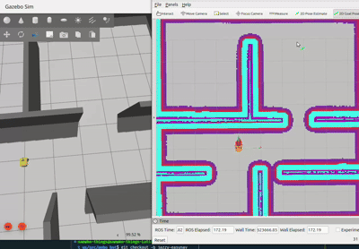

## MoboBot Gazebo Simulation | Dev PC - With EasyNav



### Some Prerequisites

- Install and set up Cyclone DDS on your PC (if you don't have it installed yet).
```shell
sudo apt install ros-jazzy-rmw-cyclonedds-cpp
```
```shell
export RMW_IMPLEMENTATION=rmw_cyclonedds_cpp
```
```shell
echo "export RMW_IMPLEMENTATION=rmw_cyclonedds_cpp" >> ~/.bashrc
```
  
- Create your MoboBot ROS Workspace
```shell
mkdir -p ~/mobo_bot_ws/src && cd ~/mobo_bot_ws && colcon build
```
```shell
source ~/mobo_bot_ws/install/setup.bash
```

- Clone the **easynav_lazy_theta_planner** package on your MoboBot ROS Workspace. this is package that would be used for the MoboBot Path Planning. A lightweight Lazy Theta-P planner for ROS 2 EasyNav by [samuko-things](https://github.com/samuko-things).
```shell
cd ~/mobo_bot_ws/src && git clone -b jazzy https://github.com/samuko-things/easynav_lazy_theta_planner.git
```
Learn more about the [**easynav_lazy_theta_planner**](https://github.com/samuko-things/easynav_lazy_theta_planner)

- Clone the **arrow_key_telop_drive** package on your MoboBot ROS Workspace. This is the package that would be used for driving the MoboBot using the arrow keys of your keyboard. developed by [samuko-things](https://github.com/samuko-things)
```shell
sudo apt install python3-pip -y && sudo apt install python3-pynput -y
```
```shell
cd ~/mobo_bot_ws/src && git clone https://github.com/samuko-things/arrow_key_teleop_drive.git
```
Learn more about the [**arrow_key_teleop_drive**](https://github.com/samuko-things/arrow_key_teleop_drive)

- Build your workspace
```shell
cd ~/mobo_bot_ws && colcon build --symlink-install
```

### Clone and Build the MoboBot (easynav branch) Packages  
- cd into the src folder of your mobo_bot_ws and download the **MoboBot** packages
```shell
cd ~/mobo_bot_ws/src && git clone -b jazzy-easynav https://github.com/robocre8/mobo_bot.git
```
  
- If you are not interested in running or testing the **MoboBot hardware** (i.e the actual robot), run the following command below. this will add the COLCON_IGNORE file to it.
```shell
cd ~/mobo_bot_ws/src/mobo_bot/mobo_bot_hardware && touch COLCON_IGNORE
```

- cd into the root directory of your mobo_bot_ws and run rosdep to install all necessary ROS  package dependencies
```shell
cd ~/mobo_bot_ws && rosdep update && rosdep install --from-paths src --ignore-src -r -y
```

- Build your mobo_bot_ws
```shell
cd ~/mobo_bot_ws && colcon build --symlink-install
```

#

### Set MoboBot Base Type Environment Variable  
- Depending on the base chassis type you want to use, run any of the command below:
  >[NOTE] you can skip this step and it would default to using 2WD chassis

```shell
export MOBOBOT_BASE_TYPE=2WD #use 2 wheel drive chassis
```
- add to your `.bashrc` file for auto sourcing 

```shell
echo "export MOBOBOT_BASE_TYPE=2WD" >> ~/.bashrc
```

#

### View Robot and Transform Tree
this shows the transformation between the differnt robot parts. it uses the **robot_state_publisher** the transforms, **RVIZ** to view the actual robot, and the **rqt_tf_tree** to view the transform graph.
- on your dev-PC, open a new terminal and launch the **tf_view** to view the transform
```shell
source ~/mobo_bot_ws/install/setup.bash && ros2 launch mobo_bot_bringup tf_view.launch.py \
use_hardware:=false
```

#

### Run the MoboBot simulation
- On your dev-PC, open a new terminal and start the mobo_bot simulation 
```shell
source ~/mobo_bot_ws/install/setup.bash && ros2 launch mobo_bot_bringup sim.launch.py \
world_name:=room_with_walls \
headless:=False \
use_rviz:=True
```
- In a different terminal, run the arrow_key_telop to drive the robot around using the arrow keys on your keyboard

```shell
source ~/mobo_bot_ws/install/setup.bash && ros2 launch arrow_key_teleop_drive arrow_key_teleop_drive.launch.py \
speed:=0.25 \
turn:=0.8 \
topic:=cmd_vel_teleop \
stamped:=True \
frame_id:=odom
```

  >NOTE: you would need to click into the rviz or simulation for the 
  > arrow_key_teleop drive to start woking. because it uses pynput
  >
  >NOTE: also feel free to use any other **teleop package** you want 
  
#

### Run the MoboBot Mapping (and move robot with teleop) - slam-toolbox
Mapping is done with the SLAM Algorithm from the slam_toolbox package. The robot is drivin aroung via telop to create the map
- to just build map of the world with slam run:
```shell
source ~/mobo_bot_ws/install/setup.bash && ros2 launch mobo_bot_bringup sim_mapping.launch.py \
world_name:=room_with_walls \
headless:=False
```
  > other worlds -> turtlebot_arena , room_with_walls_star, empty_room, bookstore

- Then drive the robot around with teleop (as done previously) and see the map being created. continue driving till you are done mapping.

- run the command below to save the `occupancy grid` map to be used later with AMCL for localization (map file would be saved in the `maps/sim` folder inside the `mobo_bot_navigation` pakage folder)
 
  >**pls ensure the map_name is exactly the same as the name of the world being used as stated above**
```shell
ros2 service call /slam_toolbox/save_map slam_toolbox/srv/SaveMap "{name: {data: '/home/$USER/mobo_bot_ws/src/mobo_bot/mobo_bot_navigation/maps/sim/<world_name>'}}"
```

#

### Run the MoboBot Navigation (With an already created Map) - AMCL localization
The robot is able to autonomously navigate using the map of the environment created in the previous step. The Adaptive Monte Carlo Localization (AMCL) algorithm from EasyNav is used to localize the robot (i.e know the where the robot is located) in the already created Map being used. With this information, the robot is able to autonomously navigate to different goal pose on the map.
>NOTE: the AMCL is configured to use the initial position of the robot at the start of the simulation

- Launch the MoboBot Naviagtion (with AMCL):
```shell
source ~/mobo_bot_ws/install/setup.bash && ros2 launch mobo_bot_bringup sim_navigation.launch.py \
world_name:=room_with_walls \
headless:=False
```

  >**NOTE**: you can change the world_name to the world you are woking with and have created a map for.

- Now use the Nav2Goal button to move the robot to any Goal pose on the map.